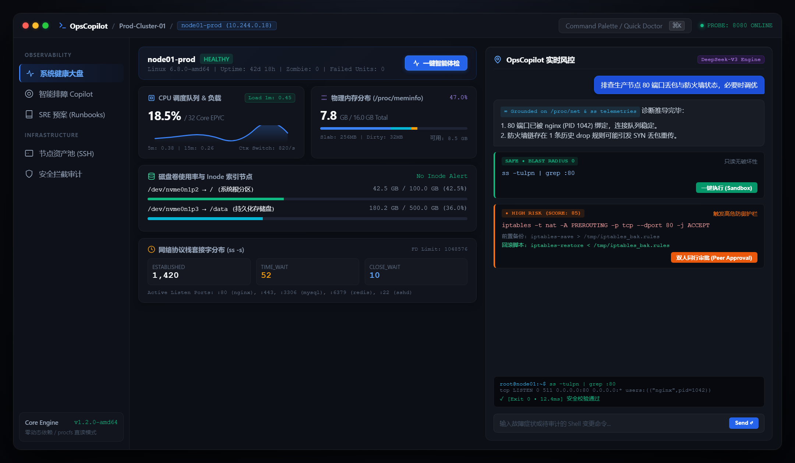

<div align="center">

# OpsCopilot

**面向现代 Linux 生产环境的智能排障副驾与命令安全拦截引擎**

[](https://golang.org)
[](https://flutter.dev)
[]()
[](LICENSE)

<br />



</div>

---

## 🌟 核心特性

- **底层指标深度可观测**：零第三方依赖直读 `/proc/loadavg`、`/proc/meminfo`（细分物理可用、Slab 内核对象与 Dirty 脏页）、`/proc/net`，关联分析 CPU 调度队列、内核 OOM-killer 事件、磁盘 Inode 与 TCP Socket 状态。
- **工业级命令安全护栏 (Guardrails)**：
  - **物理硬阻断 (BLOCK)**：AST 规则级拦截 `rm -rf /`、裸设备格式化、危险权限覆写等自毁性操作；
  - **爆炸半径评估 (Blast Radius)**：多维计算变更对监听端口、核心守护进程（`sshd`、`dockerd` 等）及网络链路的冲击面，划分安全等级；
  - **自动回滚建议**：对状态变更命令自动配对前置备份指令与撤销脚本。
- **预置 SRE 标准排障流水线 (Runbooks)**：沉淀 CPU 100% 突发、内存泄漏、磁盘 Inode 耗尽、TCP TIME_WAIT 积压等典型故障排查 SOP。
- **全平台支持**：Go 语言核心服务（单二进制 CLI / Daemon） + Flutter 跨平台前端（支持 Linux、Windows、macOS、Web 与 Android 移动端）。

---

## 🖥️ 终端演示 (CLI)

### 1. 终端一键健康体检 (`opscopilot doctor`)

```text
$ opscopilot doctor
🔍 正在采集系统底层原子指标...

===== 🎯 OpsCopilot 主机健康体检报告 (node01-prod) =====
操作系统:   linux (6.8.0-amd64)
1/5/15m负载: 0.45 / 0.38 / 0.26
物理内存:   总计 16384 MB | 已用 7820 MB (47.0%) | 可用 8564 MB
内核缓存:   Dirty脏页 32 MB | Slab结构 256 MB
僵尸进程数: 0
失败服务数: 0
✅ 近期无内核 OOM-killer 记录

网络连接状态:
  - ESTABLISHED : 280
  - TIME_WAIT   : 52
  - CLOSE_WAIT  : 10

磁盘挂载与使用:
  - /dev/nvme0n1p2  -> /         : 42.5 GB / 100.0 GB (42.5%)
  - /dev/nvme0n1p3  -> /data     : 180.2 GB / 500.0 GB (36.0%)
==================================================
```

### 2. 命令安全审计与爆炸半径评估 (`opscopilot check`)

```text
$ opscopilot check "rm -rf /*"

待审计命令: rm -rf /*
安全评级:   [BLOCK]
危险指数:   100 / 100
评估概要:   【危险阻断】检测到根目录递归删除高危命令，系统底层硬拦截

$ opscopilot check "iptables -F"

待审计命令: iptables -F
安全评级:   [HIGH]
危险指数:   80 / 100
评估概要:   【高危变更】清空或变更防火墙策略，可能导致服务端口直接暴露或断开管理员连接
前置备份:   iptables-save > /tmp/iptables_backup_$(date +%s).rules
回滚指令:   iptables-restore < /tmp/iptables_backup_*.rules
风控策略:   【强制人在回路】生产环境必须经值班人员审批后方可执行

$ opscopilot check "ss -tulpn"

待审计命令: ss -tulpn
安全评级:   [SAFE]
危险指数:   0 / 100
评估概要:   只读或安全无害操作，可直接执行
```

---

## ⚡ 快速上手

### 1. 核心引擎 (Go)

```bash
cd core

# 编译单二进制可执行文件
go build -o opscopilot ./cmd/opscopilot

# 终端体检
./opscopilot doctor

# 检查任意运维命令的安全等级
./opscopilot check "iptables -F"

# 启动后台 API 守护服务 (默认监听 8080 端口)
./opscopilot serve --port 8080
```

> **说明**：核心服务开箱自带离线智能推导规则，无需 API Key 即可独立完成指标归因与排障建议。若需接入大模型，可通过环境变量配置：
> ```bash
> export OPS_API_KEY="your-api-key"
> export OPS_BASE_URL="https://api.deepseek.com/v1"
> ```

### 2. 跨平台管理端 (Flutter)

```bash
cd ui

# 启动桌面端 / Web 端开发预览
flutter run

# 编译打包发布版本
flutter build apk --release      # Android 移动端
flutter build windows --release  # Windows 桌面端
flutter build linux --release    # Linux 桌面端
```

---

## 📐 系统架构

```
+-------------------------------------------------------------+
|             OpsCopilot 跨平台前端 (Flutter 3)                |
|  - 桌面端 / Web 端 (高信息密度仪表盘)                         |
|  - 移动端 (现场应急响应)                                     |
+-------------------------------------------------------------+
                               | (REST / WebSocket)
+-------------------------------------------------------------+
|               OpsCopilot 核心守护进程 (Go)                   |
|                                                             |
|  +--------------------+  +-------------------------------+  |
|  |   API 路由与中间件  |  |   AI 决策大脑 (ReAct/LLM)    |  |
|  +--------------------+  +-------------------------------+  |
|                                                             |
|  +--------------------+  +-------------------------------+  |
|  | 安全护栏与爆炸半径  |  |       SRE 标准 Runbook 库      |  |
|  | - AST 危险语法拦截 |  | - CPU 突发排查 SOP            |  |
|  | - 变更影响面评分   |  | - 内存 OOM 根因追踪           |  |
|  | - 回滚脚本生成器   |  | - 磁盘与 Inode 清障           |  |
|  +--------------------+  +-------------------------------+  |
|                                                             |
|  +--------------------+  +-------------------------------+  |
|  |   Linux 原子探针   |  |    SSH 多主机资产调度池       |  |
|  | /proc, /sys, ss,   |  | - 本地节点 (Localhost)        |  |
|  | dmesg, systemd     |  | - 远程主机 (SSH)              |  |
|  +--------------------+  +-------------------------------+  |
+-------------------------------------------------------------+
```

---

## 📦 模块划分

| 模块 | 说明 |
| :--- | :--- |
| **`core/probe`** | Linux 底层指标采集，解析 `/proc`、`/sys`、`dmesg` 与 `ss`，无第三方外部依赖 |
| **`core/guardrail`** | 命令安全评级引擎，内置高危规则库与爆炸半径分析算法 |
| **`core/agent`** | 融合系统探针上下文的排障大脑，支持在线模型接入与离线规则推导 |
| **`core/runbook`** | 经典运维故障标准化排查流水线 (SOP) |
| **`core/remote`** | SSH 连接池与命令受控执行器 |
| **`ui`** | Flutter 跨平台前端，支持深色终端工业风仪表盘与操作审批流 |

---

## 📄 License

[MIT](LICENSE)
